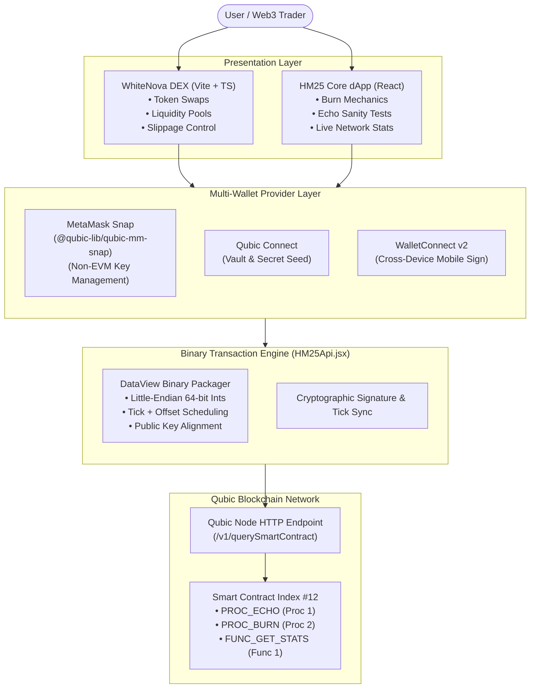

# WhiteNova ⚡ — Qubic Web3 DEX & dApp (Hackathon Madrid 2025)

<div align="center">

[](https://qubic.org/)
[](https://react.dev/)
[](https://tailwindcss.com/)
[](https://metamask.io/snaps/)
[-FF007A?style=for-the-badge)](https://qubic.org/)
[](LICENSE)

**An end-to-end decentralized application ecosystem built for the ultra-high throughput, quorum-based Qubic blockchain, developed during the Qubic Hackathon Madrid 2025 (HM25).**

[Overview](#-overview) • [System Architecture](#-system-architecture) • [Low-Level Binary Serialization](#-low-level-qubic-binary-transaction-pipeline) • [Key Components](#-key-components) • [Installation & Setup](#-installation--quickstart)

</div>

---

## 📖 Overview

**WhiteNova** is a multi-tiered Web3 platform designed to unlock native decentralized finance (DeFi) capabilities on the **Qubic Network**. Developed during the **Qubic Madrid Hackathon 2025 (HM25)**, this project tackles one of the biggest challenges in non-EVM networks: bridging user-friendly Web3 interfaces with Qubic's high-performance, tick-based bare-metal consensus architecture.

The project consists of two core layers:
1. **Qubic Core dApp (`src/`)**: A native interface directly interacting with Qubic nodes and smart contracts via low-level Little-Endian binary transaction serialization, featuring **MetaMask Snaps** integration, **Qubic Connect**, and smart contract invocation for token burning and RPC echo verification.
2. **WhiteNova DEX (`frwhitenova/`)**: A sleek, reactive Uniswap-inspired Automated Market Maker (AMM) frontend built with **Vite**, **React 18**, **TypeScript**, and **Tailwind CSS**.

---

## 🏗️ System Architecture

Unlike traditional EVM blockchains that use JSON-RPC and Solidity ABIs, Qubic utilizes a custom binary protocol executed directly by 676 computors in epochs and ticks. Our architecture bridges this gap:



---

## ⚡ Low-Level Qubic Binary Transaction Pipeline

One of the standout technical achievements of this project is avoiding heavy server-side intermediaries by implementing **client-side binary transaction serialization** directly in the browser via JavaScript `ArrayBuffer`, `Uint8Array`, and `DataView`.

### Transaction Byte Layout (Smart Contract Invocations)

Qubic transactions require exact byte alignment and Little-Endian encoding for 64-bit amounts and 32-bit ticks:

```
+-----------------------------------------------------------------------------------------+
|                                  TRANSACTION PAYLOAD (72+ Bytes)                        |
+--------------------------+-----------------------+------------------+---------+---------+
| Source Public Key (32B)  | Target Contract (32B) | Amount (8B, LE)  | Tick(4B)| Proc(2B)|
+--------------------------+-----------------------+------------------+---------+---------+
| [0 ................. 31] | [32 .............. 63]| [64 ......... 71]| [72..75]| [76..77]|
+--------------------------+-----------------------+------------------+---------+---------+
```

### Direct Buffer Construction Code snippet:

```javascript
// Excerpt from src/components/api/HM25Api.jsx
export async function buildBurnTx(qHelper, sourcePublicKey, tick, amount) {
    const finalTick = tick + TICK_OFFSET;
    const INPUT_SIZE = 0;
    const TX_SIZE = qHelper.TRANSACTION_SIZE + INPUT_SIZE;
    const tx = new Uint8Array(TX_SIZE).fill(0);
    const dv = new DataView(tx.buffer);

    let offset = 0;
    tx.set(sourcePublicKey, offset);                    // 1. Source Public Key (32 bytes)
    offset += qHelper.PUBLIC_KEY_LENGTH;
    tx[offset] = HM25_CONTRACT_INDEX;                   // 2. Contract Index 12
    offset += qHelper.PUBLIC_KEY_LENGTH;
    dv.setBigInt64(offset, BigInt(amount), true);       // 3. Amount (Little-Endian BigInt64)
    offset += 8;
    dv.setUint32(offset, finalTick, true);              // 4. Execution Tick (Little-Endian Uint32)
    offset += 4;
    dv.setUint16(offset, PROC_BURN, true);              // 5. Procedure ID (2 = Burn)
    offset += 2;
    dv.setUint16(offset, INPUT_SIZE, true);             // 6. Custom Input Payload Size

    return tx;
}
```

---

## 🧩 Key Components

### 1. WhiteNova DEX Interface (`frwhitenova/`)
- **Interactive AMM Token Swaps:** Real-time exchange rate calculation, token switching, and dynamic slippage tolerance settings ($0.1\%$, $0.5\%$, $1.0\%$, custom).
- **Modern UI / UX:** Built with Tailwind CSS, Radix UI Dialog primitives, and Lucide icons.
- **DeFi Views:** Pre-configured pages for token listings (`tokens-page.tsx`), liquidity pool management (`pools-page.tsx`), and NFT integration (`nfts-page.tsx`).

### 2. Multi-Wallet Authentication Hub (`src/contexts/`)
- **MetaMask Snap Integration:** Leverages `@qubic-lib/qubic-mm-snap` to derive Qubic keypairs inside MetaMask, allowing traditional Web3 users to sign Qubic transactions without external wallet installations.
- **Qubic Connect & Vault:** Direct integration with official Qubic Vault and secret seed handling.
- **WalletConnect v2:** Mobile-friendly QR modal for decentralized device linking.

### 3. Smart Contract Interactions (`HM25Api.jsx`)
- `PROC_BURN` (`Index 12`, `Proc 2`): Deflationary token burning protocol on the Qubic chain.
- `PROC_ECHO` (`Index 12`, `Proc 1`): Network round-trip latency and node health validation.
- `FUNC_GET_STATS` (`Index 12`, `Func 1`): Reads base64-encoded binary buffers from `/v1/querySmartContract` and unpacks 64-bit call counts directly using `buf.readBigUInt64LE()`.

---

## 🚀 Installation & Quickstart

The repository contains both the core integration app and the WhiteNova DEX interface.

### Prerequisites

- **Node.js** `>= 18.0.0`
- **pnpm** or **npm** (for the root app)
- **Bun** or **npm** (for the `frwhitenova` DEX)

---

### Running the HM25 Qubic Core dApp

```bash
# 1. Enter repository root
cd Hackathon-Vottum-Qubic

# 2. Install dependencies
pnpm install
# or: npm install

# 3. Start local development server
pnpm start
# App will launch on http://localhost:3000
```

---

### Running the WhiteNova DEX Interface

```bash
# 1. Enter the DEX directory
cd Hackathon-Vottum-Qubic/frwhitenova

# 2. Install dependencies
npm install
# or with bun: bun install

# 3. Launch Vite development server
npm run dev
# or: bun run dev --host
# Access the DEX on http://localhost:5173
```

<details>
<summary><b>🛠️ Available Build & Test Scripts</b></summary>

```bash
# Build Core dApp for production
pnpm run build

# Build WhiteNova DEX for production
cd frwhitenova && npm run build

# Run TypeScript typechecks & linter
cd frwhitenova && npm run lint
```
</details>

---

## 📊 Technical Specifications Summary

| Feature | Implementation | Purpose |
| :--- | :--- | :--- |
| **Consensus Target** | Qubic Computor Quorum (Ticks) | Sub-second bare-metal transaction finality |
| **Transaction Format** | 72+ Byte Binary Buffer | Low overhead, zero ABI serialization lag |
| **Numeric Endianness** | Little-Endian (`DataView`, `BigInt64LE`) | Direct hardware alignment with Qubic node core |
| **Wallet Protocol** | MetaMask Snaps + Qubic Connect | Bridges Ethereum userbase to Qubic ecosystem |
| **DEX Stack** | Vite + React 18 + TypeScript | Instant HMR, type safety, sub-millisecond responsiveness |

---

- In collaboration with the **Qubic** and **Vottum** developer community.
